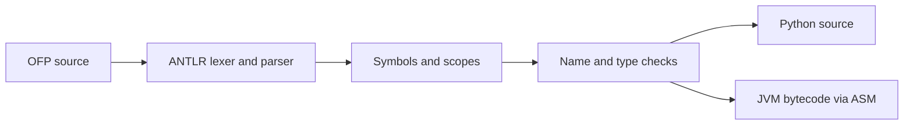

# OFP Compiler

OFP Compiler explores what happens between writing a program and running it. It
takes a small program, checks it for mistakes, and translates it into **Python
source** or **JVM bytecode**, a format the Java runtime can execute.

Built in **Java with ANTLR and ASM** as a university project for **Code
Transformation and Interpretation**.

## Overview

When someone writes a program, its instructions need to be understood and checked
before they can be executed. This project implements those steps for a small
programming language called OFP.

The same OFP program can be translated into two different forms and run through
either Python or Java. This makes it possible to explore how a program's meaning
is preserved when its representation changes.

The included examples range from printing a greeting to sorting arrays and
working with text. They provide a way to try the language and follow the
compilation process without needing to understand the whole implementation first.

## What you can do

- **Write and run small programs:** Try calculations, repeated tasks, decisions,
  and reusable functions.
- **Get feedback on mistakes:** See where a program uses an undeclared name,
  assigns the wrong kind of value, or breaks a language rule.
- **Compare two ways of running the same program:** Generate Python code or a
  Java-compatible class file from the same OFP source.
- **Inspect the translation:** Read the generated Python and explore how
  higher-level instructions become executable code.

## A typical workflow

1. Choose a program from the [examples](examples/README.md), starting with
   `hello_world.ofp`.
2. Check it for errors, then run it to see the result.
3. Change a value, condition, or function and observe how the output changes.
4. Try the other backend and compare the result, or inspect the generated code.

The commands below handle building and running the project.

## Learning focus

The project connects programming-language theory with a working implementation.
Its main learning areas include:

- Turning a set of language rules into a program that can read and check code.
- Breaking a complex process into smaller components with clear responsibilities.
- Producing useful feedback when input is incorrect.
- Testing that two different implementations preserve the same program behavior.

The technical sections below explain the grammar, symbol tables, type checking,
and code generation that make this possible.

## Quick start

Install **JDK 17+** and **Python 3.11+**, with `java`, `javac`, and `python` on your
`PATH`. The required Java libraries are included in `lib/`; no package installation
or dependency downloads are needed.

From the project root:

```sh
python ofp.py run examples/hello_world.ofp
```

```text
Hello, world!
```

The launcher builds the compiler automatically. Try the same program through the
Python backend, then run the full test suite:

```sh
python ofp.py run examples/hello_world.ofp --backend python
python ofp.py test
```

## A language example

```ofp
int sumUpTo(int limit) {
    int total = 0;
    int current = 1;
    while (current < limit + 1) {
        total = total + current;
        current = current + 1;
    }
    return total;
}

void main() {
    println(sumUpTo(10));
}
```

OFP supports functions and recursion, `if`/`else`, `while`, numeric and boolean
values, characters, strings, and one-dimensional arrays. See the
[language guide](docs/language.md) for syntax, type rules, and limitations.

## Compiler pipeline



Both backends use the same frontend. Syntax and semantic errors stop compilation,
include line and column information, and return a failing exit code.

The [architecture walkthrough](docs/architecture.md) explains each pass and links
to its implementation.

## Commands

| Task | Command |
| --- | --- |
| Build the compiler | `python ofp.py build` |
| Check a program | `python ofp.py check examples/language_overview.ofp` |
| Run JVM bytecode | `python ofp.py run examples/recursion.ofp` |
| Run generated Python | `python ofp.py run examples/recursion.ofp --backend python` |
| Generate Python for inspection | `python ofp.py compile examples/recursion.ofp --backend python` |
| Generate a JVM class | `python ofp.py compile examples/recursion.ofp --backend jvm` |
| Run all tests | `python ofp.py test` |
| Show options | `python ofp.py --help` |

`jvm` is the default backend. Compilation output goes under `build/programs/`;
use `compile -o <file>` to choose another output path. Generated code stays separate
from the source examples.

The recursion example prints `39`, `4`, and `34` on separate lines with either
backend. Browse the [example programs](examples/README.md) for arrays, sorting,
string processing, and other language features.

## Project layout

```text
.
|-- ofp.py                    Build and command-line launcher
|-- src/main/
|   |-- antlr/OFP.g4          Language grammar
|   `-- java/ofp/
|       |-- cli/              Java command-line entry point
|       |-- compiler/         Shared compilation pipeline
|       |-- semantics/        Symbol, reference, and type passes
|       |-- symbols/          Scope and symbol data structures
|       |-- types/            OFP type definitions
|       `-- codegen/          Python and JVM generators
|-- examples/                 Small programs demonstrating the language
|-- tests/
|   |-- valid/                Regression programs
|   |-- invalid/              Invalid programs and expected diagnostics
|   `-- expected/             Expected stdout for valid programs
|-- docs/                     Architecture, language, and development guides
|-- lib/                      Bundled ANTLR and ASM dependencies
`-- .github/workflows/        Automated test workflow
```

## Testing and development

Tests rebuild from the grammar and Java sources, check every example, execute both
backends against expected output, and verify that invalid programs are rejected.
Regression cases cover mixed numeric arithmetic, parentheses, integer division,
block shadowing, array literals, and returning from `main`.

```sh
python ofp.py test
```

Full test output is saved to `build/test-results.json`. The GitHub Actions workflow
is configured for Windows and Linux with JDK 17 and Python 3.11.

See [development instructions](docs/development.md) for adding tests, inspecting
generated code, troubleshooting, and using the included VS Code workspace.

## Scope

This is an educational compiler. The grammar deliberately keeps the language small,
and the semantic passes do not yet prove definite assignment or that every path in
a non-void function returns. Integer overflow and some runtime error behavior can
differ between targets. These boundaries are described in the
[language guide](docs/language.md#deliberate-scope-and-remaining-limitations).

The original assignment stages map to the current grammar, `check`, and the two
backends; see the [stage mapping](docs/architecture.md#original-assignment-stages).
ANTLR and ASM remain third-party dependencies, listed in [lib/README.md](lib/README.md).

Developed for the **4DT902 "Code transformation and interpretation"** Master's level course at Linnaeus University Växjö, fall 2025.
