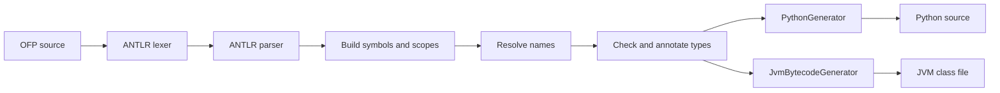

# How the compiler works

OFP takes the same source program through one frontend and then selects one of two
backends. The frontend is shared so both targets accept and reject the same input.

## 1. Lexing and parsing

[`OFP.g4`](../src/main/antlr/OFP.g4) defines both the tokens and the parser rules.
ANTLR generates Java lexer, parser, listener, and visitor classes during the build.
Generated sources live under `build/compiler/`; they are not maintained by hand.
The launcher also copies the current generated Java sources to `build/generated-src/`
so the editor can resolve parser classes through a stable source path.

The entry rule requires one `void main()` function, permits functions before and
after it, and requires the end of the input. Both lexer and parser errors stop the
pipeline before semantic analysis.

## 2. Symbols and lexical scopes

[`SymbolTableListener`](../src/main/java/ofp/semantics/SymbolTableListener.java)
creates a global scope, function scopes for parameters, and scopes for blocks.
Each scope stores its symbols and points to its enclosing scope. Lookup walks
outward until it finds a declaration.

The scope for each relevant parse-tree node is stored in an ANTLR
`ParseTreeProperty<Scope>`. Later passes use the same scopes instead of rebuilding
them. Function symbols also retain their parameter types and return type.

Building all symbol tables before checking references allows a function to call
another function declared later in the file, including recursive calls.

## 3. References and type checking

[`ReferenceCheckListener`](../src/main/java/ofp/semantics/ReferenceCheckListener.java)
reports undeclared variables and functions.
[`TypeChecker`](../src/main/java/ofp/semantics/TypeChecker.java) then checks
initializers, assignments, function arguments, return statements, conditions,
array accesses, and expressions.

The type checker records each expression's type in another parse-tree property.
These annotations let the Python backend distinguish integer division from float
division and let the JVM backend select instructions and insert numeric conversions.

[`CompilerPipeline`](../src/main/java/ofp/compiler/CompilerPipeline.java) owns this
sequence. Each phase must succeed before the next runs. Diagnostics contain a
one-based line and a zero-based column. Invalid input produces no new output file.

## 4. Python generation

[`PythonGenerator`](../src/main/java/ofp/codegen/PythonGenerator.java) emits Python
functions, conditionals, loops, lists, and calls. The OFP entry point becomes an
`_ofp_main()` function so `return;` keeps its meaning.

Names that conflict with Python keywords or built-ins are renamed. Shadowed block
variables receive distinct Python names because Python itself uses function scope.
Integer division uses a small generated helper to truncate toward zero.

## 5. JVM bytecode generation

[`JvmBytecodeGenerator`](../src/main/java/ofp/codegen/JvmBytecodeGenerator.java)
uses ASM to emit a class with static methods. ASM computes stack frames and maximum
stack sizes. OFP `float` maps to JVM `double`; arrays map to the corresponding JVM
array types.

Local slots and parameter positions are associated with symbol objects so nested
declarations with the same spelling remain distinct. For mixed numeric arithmetic,
each integer operand is converted while it is on top of the operand stack.

The emitted class targets Java 8 bytecode. The compiler implementation itself
requires JDK 17 or newer.

## Tooling boundary

[`ofp.py`](../ofp.py) handles parser generation, Java compilation, command-line
options, and executing the generated program. The compiler logic stays in Java.
The launcher uses the Python standard library and the three bundled JAR files.

Builds are cached by a hash of the launcher, grammar, Java sources, bundled JARs,
and compiler executable path. `build --rebuild` and `test` create fresh build
directories. All build products are ignored by Git.

## Original assignment stages

| Original stage | Current location or command |
| --- | --- |
| A1: grammar and parse trees | `src/main/antlr/OFP.g4`; VS Code's **Debug OFP parse tree** configuration |
| A2: semantic analysis | `python ofp.py check <file.ofp>` |
| A3: Python translation | `python ofp.py compile <file.ofp> --backend python` |
| A4: JVM bytecode | `python ofp.py compile <file.ofp> --backend jvm` |

The previous `MainA2`, `MainA3`, and `MainA4` drivers are replaced by
[`ofp.cli.Main`](../src/main/java/ofp/cli/Main.java). This removes their duplicated
parsing code and makes validation consistent across commands.
